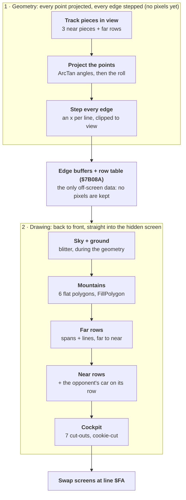

# How Stunt Car Racer's 3D rasteriser works

November 2026. An explainer of the race view's drawing, from the track data to the finished screen.
The measurements behind it, and the costs routine by routine, are in [RENDER.md](RENDER.md).

## At a glance

The rasteriser works in two passes each frame. First the CPU turns the visible track into edge lists without writing a pixel. Then it paints the view back to front, straight into the hidden screen.



The edge buffers and the row table are the only hand-off between the two passes: the drawing never looks at 3D coordinates again. In the enhanced game, on an A500, the geometry takes 39 ms a frame, the drawing 50 ms and the cockpit 7 ms.

## The screen

The game draws straight into the screen, with no off-screen picture and no depth buffer. There are two screens: the CPU draws into the hidden one (`ScreenDraw`) while the other is shown.

- **Format:** each screen is 320 x 200 pixels in 16 colours: 4 bitplanes of 8,000 bytes (`$1F40`) one after another, 32,000 bytes in all, 40 bytes a line. The planes are not interleaved, so every 16 pixels cost 4 separate writes, one per plane, `$1F40` bytes apart.
- **The view:** the 3D view is a 256 x 128 window inside the screen, at `ScreenDrawTop` (`ScreenDraw` + `$284`: line 16, pixel 32). Everything below works in view coordinates, x 0-255 and y 0-127.
- **The cockpit picture:** it is unpacked into both screens at the start of a race and never redrawn outside the view.
- **The flip:** at the end of a frame `FrameLimiter` swaps the screens (`FlipScreens`). The copper interrupt at line `$FA` then points the display at the new one, so the screen just drawn is shown from the next frame.
- **Colours:** a polygon's colour (0-15) becomes four plane masks, each all ones or all zeros (`ColourToMasks`), and one of 15 `PlotWord<colour>` routines for partial words.

## What is drawn

The track is a strip built from pieces, and each piece is cut into cross-sections. A cross-section is a pair of points, the left and right edges of the road, each with a height. Joining one cross-section to the next gives the road's surface between them.

- **Near pieces:** the piece the car is on and the next two are read in full (`ReadPiecePoints`, with heights from `PiecePointHeight` and `InterpolatePiece`) and projected with full precision (`ProjectNearPiece`, 3 times a frame).
- **Far pieces:** each piece has a list of the pieces visible from it (`$7AA1A`, one pointer per piece). `ProjectFarPieces` walks that list, projecting each cross-section with less precision, until the per-piece limit or until the track leaves the view. On a straight that is 12 cross-sections; F4 in the enhanced game stops at 6.
- **Rows:** each cross-section becomes a row of the row table at `$7B08A`: 32 bytes a row, 7 pointers to edge buffers and flags at `+$1C` and `+$1E`, with `RowOffset` the current row. `EdgesFirstPiece`, `EdgesNextPiece` and `EdgesFarPieces` build them. The opponent's car has rows of its own from `$5E0`.
- **Other things in the view:** the sky and ground, the horizon's mountains (6 flat polygons), the lines along the track's edges, the opponent's car (only when its distance is 10-3,199), and the cockpit over the bottom and corners.

## Projection

The game projects by angle, not by dividing by depth. A point's screen x is the angle at which the camera sees it, less the car's heading; its screen y is the angle of its height over its distance, less the car's pitch. The one division is inside `ArcTan`.

```math
x_{screen} = \frac{\operatorname{atan2}(x, z) - heading}{32} + 128 \qquad y_{screen} = \frac{\operatorname{atan2}(h_{camera} - h, d) - pitch}{32} + 64
```

Angles are 16-bit, with `$10000` a full turn. One pixel is 32 angle units, about 0.18 degrees, so the 256-pixel view spans 45 degrees across and 22.5 degrees down.

1. **Across (`ProjectPointX`):** `ArcTan` of the point's x and z relative to the camera, less the heading (`dat_1BC2E`), shifted down by 3. Far points (`ProjectPointXFar`) also get their distance from `VectorLength`.
2. **Up (`ProjectPointY`):** the camera's height less the point's (`PointHeights`), against its distance, through `ArcTan`, less the pitch (`dat_1BC42`). Near points scale the height by 0.594 first (`muls #$4C1B`).
3. **Roll (`RollPointXY`):** the x, y pair is turned about the view's centre by the car's roll, with 4 `muls` using the matrix's sine and cosine (`ViewMatrix+$20`, `+$22`). It is then divided by 4 and centred (`+$80`, `+$40`). Points behind the camera are not turned.
4. **Results:** `PointScreenX` and `PointScreenY`, one word per point, in view pixels. They can lie far outside 0-255 and 0-127; clipping happens per edge, next.

`ArcTan` divides the smaller of the two values by the larger (`divu`), looks the ratio up in a 2,048-entry table (`ArcTanTable`) and fixes the octant. Linear-in-angle projection differs from true perspective by about 5% at the view's edges, so a long straight edge would bend slightly. The game draws straight lines between projected points, and over a 45-degree view the difference is hard to see.

## Edges

Every polygon is described by its edges, and every edge is turned into a list of x positions, one per screen line. `ScanEdge` does this for each edge between two projected points and stores the list in an **edge buffer**.

- **Where:** edge buffers are allocated one after another from `EdgeBufferNext` in the race work area, `$3D80` up to `$60A8` (up to about 9 KB a frame). When the area is full, the edge is dropped and its row-table slot marked empty (`$80000000`).
- **Format:** an 8-byte header (bottom line, top line, x at the bottom, x at the top), then one x word for each line from the bottom up, ended by `$8000`.
- **The row table:** the buffer's address goes into the current row's slot (`$7B08A` + `RowOffset`). If the points had to be swapped to put the lower one first, bit 6 of the slot's top byte is set, so the filler knows the edge's direction.
- **Clipping:** each end gets an outcode (left of 0, right of 255, above 0, below 127), and the edge is clipped to the view. Lines the edge crosses outside the view's sides are filled in with the side's x (`dat_668A2`, `dat_668A4`), and an edge wholly off one side becomes the view's side (`EdgeOffSide`). Either way, a surface's fill still closes.
- **Stepping:** a Bresenham-style digital line. The error term starts at half the major length, negated. Each step adds the minor length, and a carry means a step in the other direction. Steep edges (y-major) write one x per line. Shallow edges (x-major) are stepped a pixel at a time, writing an x each time the line changes.

The track's cross-section edges run across the screen, so most are shallow. In the original, that made `ScanEdge` the most expensive routine in the game: 15.6% of a frame.

## Filling

The track is drawn far to near, the painter's order: `DrawFarRows`, then `DrawNearRows`. Nothing tests what is hidden; nearer surfaces are simply drawn over farther ones. For each row, the game fills the surfaces between that row and the next, draws the lines along them, and draws the opponent's car if it is on that row.

**Gathering a surface (`FillRowSurface`).** It collects the edges around one surface from the row table into a list (`dat_69B7C`). `FillBetweenEdges` then sorts them into a left chain and a right chain (`dat_69BFC`) and starts at the surface's lowest line.

**One line at a time, bottom to top (`FillBetweenEdges`).** For each screen line:

1. Read the left and right x from the current left and right edge buffers. When a buffer reaches its end marker, move on to the next edge in that chain. When another pair of edges starts partway up the surface (the line in `dat_69ACE`), the current state is pushed, that part is filled, and the fill then resumes.
2. If both x fall in the same 16-pixel word, write one masked word.
3. Otherwise write a partial word at the left, with mask `$FFFF >> (x & 15)`, through `PlotWord<colour>`. For each plane, that ORs in the mask where the colour has a 1 and ANDs it out where it has a 0.
4. Write the whole words between with plain moves, one per plane.
5. Write a partial word at the right, with mask `NOT ($FFFF >> (x & 15))`.
6. Step up a line (`-40` bytes) and repeat until the surface's top.

**`FillPolygon`** is a smaller version for simple polygons: the mountains, the opponent's car and the horizon's tilted band. It has four edges, two chains of two.

All the cost is per line and per edge: the variables are kept in memory, there are calls for each partial word, and every edge is stepped. The pixels themselves are cheap. In the original, `FillBetweenEdges` spent about 28 cycles per word written, against 7 for the plain fill of the sky and ground.

## Lines, background, mountains, cars and cockpit

- **Sky and ground (`DrawHorizon`), drawn first.** The horizon is an edge between two points far to the left and right (x of -$500 and $500), pitched and rolled like any other point. Everything below its top line is filled with the ground colour ($D) and everything above with the sky (7). The tilted band between the horizon's top and bottom lines is then filled with sky up to the horizon edge (`FillPolygon`), so a rolled horizon gets a sloped edge. This is the whole view written once, 8,192 words, before anything else is drawn.
- **Mountains (`DrawMountains`).** 6 flat polygons sitting on the horizon, projected and rolled like the track. Their 23 edges mostly cross the view's sides, so each is clipped. They are filled with `FillPolygon`, a fixed cost of about a tenth of the frame on any track.
- **Lines along the track (`DrawEdgeLine`).** The kerb lines are edge buffers drawn as single pixels. In the original, each pixel was a `PlotPixel` call setting or clearing one bit in each of the 4 planes, about 365 pixels a frame at about 180 cycles each.
- **The opponent's car (`DrawCarAtRow`, `DrawOpponentCar`).** Its model is projected into the row table's car rows from `$5E0`. It is filled with `FillPolygon` when the painter's order reaches the row it is on, so nearer track is drawn over it correctly. In view it adds up to 300 raster lines of work.
- **The cockpit (`DrawCutout`), drawn last.** 52 cut-outs were masked from the cockpit pictures at start-up (`MakeCutouts`); 7 are drawn each frame over the view: the engine along the bottom, the dashboard's top, the rounded corners. Each one reads the screen, ANDs it with the mask, ORs in the picture and writes it back, in every plane. 3,478 pixels of the view (10.6%) are covered, and whatever the view drew there is lost. The chains are sprites (`MoveChains`), not drawn into the screen.

## Where the time goes

On an A500 a race frame's work fell from 133 ms in the release to 107 ms in the enhanced game. Geometry, the projection and edge stepping, is now the largest part after the drawing.

| Phase | Release (ms) | Enhanced now (ms) | What |
| --- | ---: | ---: | --- |
| Input | 4.8 | 4.7 | the controls, the car's physics, the engine sound |
| Cars | 3.2 | 3.9 | the cars placed on the track, the opponent |
| Geometry | 42.1 | 39.0 | points projected and rolled, edges clipped and stepped |
| Drawing | 65.0 | 49.7 | sky and ground, mountains, surfaces, lines, cars |
| Cockpit | 15.6 | 7.4 | the cut-outs drawn over the view |
| Rest | 2.5 | 2.6 | the drawbridge, the instruments |
| **Total work** | **133.2** | **107.3** | 6.65 and 5.36 vertical blanks |

By routine, the enhanced game's work now goes mostly to edge stepping (`ScanEdge`, `ScanEdgeInView`, `ScanXMajor`: 13%), span filling (`FillBetweenEdges`: 9%), the track's lines (`DrawEdgeLine`, `EdgeFlush`: 7%), `ArcTan` (5%), `FillPolygon` (4%) and the roll (`RollPointXY`: 3%).

Figures are from the benchmark race in the emulator (`enhanced/tools/bench.py`: Little Ramp, a minute at full throttle, release timing), fitted to an A500 within 1.2%. The release's column is from [RENDER.md](RENDER.md).

## What the enhanced game changed

The enhanced game keeps the same pipeline and, unless an option is switched on, draws exactly the same pixels, checked frame by frame against the previous build in the emulator. The changes make each stage cheaper, move work to the blitter, or add options that draw less.

| Stage | Change | Effect on the race's work |
| --- | --- | --- |
| Edges | Shallow edges stepped a line at a time: each line's run found by one division (`ScanXMajor`), not pixel by pixel | 4.5% less |
| Edges | Edges with both ends in view skip the outcodes and clipping, and have their own lean stepping and exit (`ScanEdgeInView`) | 1.1% for the lean path; the clipping skip came with the line change |
| Edges | Edges clipped only at the view's sides (both ends' y in view) skip the bit-by-bit outcodes and the four y tests, and join the release's clipping where it deals with the sides (`scanside.i`); the mountains' points worked out without the roll's calls when the car is level | 0.5% less |
| Lines | Each line's run of kerb pixels written a word at a time (`EdgeFlush`), not one `PlotPixel` call per pixel | 3.5% less |
| Filling | Whole words written two per plane at once (`move.l`), unrolled; partial words call `PlotWord<colour>` directly with computed masks; also in `FillPolygon` | about 3% less |
| Cockpit | The cut-outs drawn by the blitter's cookie-cut, from copies made at start-up | the cockpit's time halved (15.6 to 7.2 ms) |
| Sky and ground | Filled by the blitter, and queued during the geometry so the CPU never waits (`blitqueue.i`) | 6.4% less in two steps |
| Projection | The roll skipped when the car is level (`RollPointXY`) | small; the result is identical |
| All | No self-modifying code: colours chosen through stored addresses, so the game runs on 68020 and later | cost 2.3%, since won back |

Options that change what is drawn, all toggled in a race:

- **F4:** the track drawn to 6 cross-sections ahead instead of 12. 15% less work.
- **F6:** the cockpit off.
- **F9:** the view drawn in 64 lines and doubled by the blitter. About 10% less work.
- **F10:** the mountains off. About 11% less work.

Smooth motion is separate from the rasteriser. The physics runs at a fixed 8.33 steps a second, and on a fast enough machine the view is drawn several times between steps, with the cars' positions and angles blended (`interp.i`). On an A500 there is no time for extra pictures, so each frame shows the latest step, as in the release.

The ways the view could be drawn differently are in [`enhanced/TODO.md`](../../enhanced/TODO.md) under "The view drawn another way": blitter-filled polygons, a front-to-back span buffer, a whole-view blitter fill, and chunky-to-planar.
