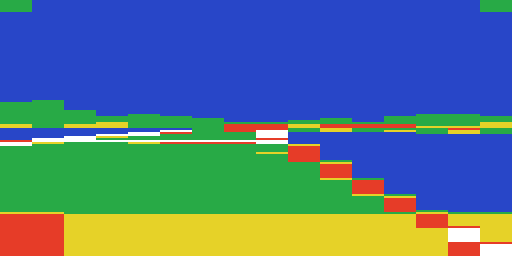

# The 3D view and the drawing

How the game draws the race, what each part costs, and where the time could be won. Everything
here was measured with the telemetry build and the study emulator: the race benchmark
(`enhanced/tools/bench.py`: Division 4's first race, Little Ramp, against Jumpin' Jack, a minute
of it with the throttle held) timed by phase (`enhanced/src/telemetry.i`), and the same race
profiled by routine (scremu's `profile` and `callprof`). The emulator counts each instruction's
68000 cycles at 7.09 MHz and takes 6 cycles of each raster line for the display's DMA - fitted to
an A500, whose calibration run (`enhanced/src/calibrate.i`) it matches within 1.2%
(`enhanced/measurements/`) - so these are an A500's figures, and exact for comparing one version
of the game with another. (The routines' shares below were profiled before the fit; the fit
moved the phases' shares by less than 1%.)

## What limits the frame rate

`FrameLimiter` lets a race frame start at most every 6 vertical blanks (8.33 a second). On an A500
the work of a frame takes longer than that: **6.65 vertical blanks on average (133.3 ms)**, so the
race runs at **7.5 frames a second** and `FrameLimiter` almost never waits (0.1 ms a frame). Of 552
frames, 270 took 6 vertical blanks, 187 took 7, 87 took 8 and 8 took 9 - the longer ones when the
opponent's car is in view (its drawing adds up to 300 lines) and every 4th frame, when the
instruments' digits are printed (130 lines).

So the release's turbo (F3, which removes the wait) does nothing on an A500: the drawing is the
limit. Faster drawing gives the frames back up to the limit of 6; beyond that, the limit must
change - and the game is simulated **a step a frame**: `CarPhysics` and the opponent run once a
frame and nothing in the race measures the time a frame took. A frame rate above 8.33 needs either
a smaller limit with the physics stepped as before every 6 vertical blanks (and the view drawn more
often than the physics, the cars' positions in between interpolated), or the physics changed for
a shorter step.

## A frame, by phase

| Phase | ms | Share | What |
|---|---:|---:|---|
| input | 4.8 | 3.6% | the controls, `CarPhysics`, the engine's sound |
| cars | 3.2 | 2.4% | the cars placed on their pieces, the opponent |
| geometry | 42.1 | 31.6% | the pieces in view: points rotated and projected, the edges clipped and stepped |
| drawing | 65.0 | 48.7% | the sky and ground, the mountains, the track's surfaces and lines, the opponent's car |
| cockpit | 15.6 | 11.7% | the cockpit's parts drawn over the view (`DrawCutout`), the chains |
| rest | 2.5 | 1.9% | the drawbridge, the instruments |
| wait | 0.1 | 0.1% | `FrameLimiter` |

(The first version of the telemetry now and then read its clock a frame ahead - the beam read on a
frame's last line, the vertical blank arriving before the interrupt request was read - which put
a phase of 65,000 lines into the totals: the cockpit's share was given as 16.5%. Fixed, and the
baseline measured again.)

## The pipeline

`RaceView` (called by the race loop once a frame) does it all; the CPU draws every pixel (the
blitter is not used in the race).

1. **The cars.** Each car placed on its piece of track (`PlaceCarOnTrack`, `MoveOpponent`).
2. **The near pieces.** The piece the car is on and the next two: their points read
   (`ReadPiecePoints`: heights from the piece's shape, `PiecePointHeight`, `InterpolatePiece`),
   turned by the view's matrix (`RollPoint`, `RollPointXY`) and projected (`ProjectPointX`: an
   `ArcTan` of the point's x and z less the car's heading; `ProjectPointY`) into `PointScreenX` and
   `PointScreenY` - `ProjectNearPiece`, 3 times a frame.
3. **The far pieces.** Each piece has a list of the pieces seen from it (`$7AA1A`: a pointer a
   piece); those are projected the same way with less precision (`ProjectFarPieces`,
   `ProjectPointXFar`, `ProjectPointYFar`).
4. **The edges.** Each edge between two projected points is clipped to the view (256 x 128 pixels:
   outcodes) and stepped a line at a time (`ScanEdge`); its x on each line goes into an **edge
   buffer** (a word a line, from `EdgeBufferNext`: in the race work area, `$3D80` up to `$60A8`).
   The track is a strip, cut into cross-sections: each cross-section is a **row** of the row table
   at `$7B08A` (32 bytes a row: 7 edge pointers, flags at `+$1C` and `+$1E`; `RowOffset` the
   current one; up to `$5E0`, the opponent's car's rows after). `EdgesFirstPiece`,
   `EdgesNextPiece` and `EdgesFarPieces` build the rows. An edge wholly off one side becomes the
   view's side (`EdgeOffSide`), so that the fill still closes.
5. **The background.** `DrawHorizon` fills the whole view with sky above and ground below the
   horizon (the horizon is an edge too: it tilts with the car's roll); `DrawMountains` draws the
   mountains as polygons (`ScanEdge`, `FillPolygon`).
6. **The track, far to near** (the painter's order). `DrawFarRows`, then `DrawNearRows`: for each
   row, the surfaces between it and the next (`FillRowSurface` gathers their edges,
   `FillBetweenEdges` fills them a line at a time), the lines along the track (`DrawEdgeLine`: an
   edge buffer drawn as single pixels with `PlotPixel`), and the opponent's car when the row is its
   row (`DrawCarAtRow`, `DrawOpponentCar`: its model's edges in rows from `$5E0`, filled with
   `FillPolygon`; only when its distance, `OpponentDistance`, is 10-3199).
7. **The cockpit.** The parts of the car in front of the driver drawn over the view
   (`DrawCutout`: the 52 cut-outs `MakeCutouts` masked from the pictures at start-up, 7 drawn a
   frame), the chains (`MoveChains`).
8. **The instruments, then `FrameLimiter`**: the screens swapped (`ScreenDraw`, `ScreenBack`;
   the copper interrupt shows the new one at line `$FA`).

### How the polygons reach the screen

There is no off-screen picture: every polygon is filled straight into the screen being drawn -
the hidden one of two (`ScreenDraw`; `FrameLimiter` swaps it with the one on show, and the copper
interrupt at line `$FA` shows it). What is kept off the screen is only what describes the
polygons, never their pixels:

* the projected points (`PointScreenX`, `PointScreenY`);
* the **edge buffers**: for each edge, its x on every line it crosses (a word a line), built by
  `ScanEdge` in the race work area (`$3D80-$60A8`, up to about 9K a frame);
* the **row table** at `$7B08A`: for each cross-section of the track, pointers to its edges' buffers
  - the polygon list;
* for the surface being filled, the list of its edges (`dat_69B7C`) and their left/right order
  (`dat_69BFC`).

A surface is filled a line at a time (`FillBetweenEdges`): between its left and right edges' x on
that line, the partial words at the two ends through `ClearWordPlanes` (and so `PlotWord<colour>`:
read, mask, or, write in each plane), the whole words between with a `move.w` to each of the 4
planes (the planes are 8,000 bytes apart, not interleaved: 4 separate writes for every 16 pixels).
The order is the painter's: everything is drawn far to near over what was there, with no depth
buffer and no test of what is hidden.

### The screen

Two screens of 32,000 bytes (`$7D00` apart), each 4 bitplanes of 320 x 200 one after the other
(8,000 bytes, `$1F40`, a plane; 40 bytes a line). The view is 256 x 128 pixels at `ScreenDrawTop`
(line 16, pixel 32).

### Colours by changing the code

The drawing routines are given a colour by rewriting themselves: `SetPolygonColour` turns each of
`PlotPixel`'s `bset` instructions (`PlotPixelP0Hi` ... `PlotPixelP3Lo`) into `bclr` or back, one per
plane; the fills patch the displacement of `ColourWordJump`'s branch so that it goes to
`PlotWord<colour>` (15 routines, one per colour, each or-ing the planes of its colour and clearing
the others).

## Overdraw

Measured by counting every write to the screens in the benchmark's race
(`original/tools/scremu/overdraw.py`): a word of the view is written **1.87 times a frame** on
average (the median word once; at most 23 times). 15,969 words are written to the screen a frame,
where the view written once is 8,192 (2,048 words in each of 4 planes).

| Where | Writes a word | Why |
|---|---:|---|
| the sky (lines 0-47) | 1.0 | `DrawHorizon` only |
| the mountains (lines 48-63) | 1.2-2.3 | the sky, then the mountains over it |
| the horizon band (lines 64-71) | up to 7 | the far rows of the track, each a few lines tall, stacked by the painter's order, with their lines (`PlotPixel`: a byte write a plane a pixel) |
| the track (lines 72-103) | 2.0 | the ground, then the track's surface over it; off the track, 1.0 |
| the bottom (lines 104-127) | 2.6-5.5 | the ground, the track, then the cockpit over both |

By routine: `DrawHorizon` 8,209 (51% - the whole view, once), `FillBetweenEdges` and the
`PlotWord`s 3,460 (22%), `DrawCutout` 2,295 (14%), `PlotPixel` 1,460 (9%), `FillPolygon` 304,
the instruments' digits 201.

So the overdraw is moderate - less than 2 - and most of it is the ground under the track and the
cockpit over the bottom of the view. It is not what makes the drawing slow: `DrawHorizon` writes
its 8,192 words in about 56,000 cycles (7 a word, `move.l`s), while `FillBetweenEdges` spends about
98,000 cycles on its 3,460 (28 a word): the time goes on the work for each line and each edge -
the variables kept in memory, the edges stepped a pixel at a time - not on the pixels written
twice. The waste that would pay to remove: the ground drawn under the track (the track's area
filled twice), and everything under the cockpit's solid parts (below).

## The cockpit

The cockpit is a picture (`Pic_Cockpit`) unpacked at the start of each race into the first
screen and copied to the second (`UnpackCockpit`). Outside the view it is never drawn again: the
3D view writes only inside its 256 x 128 rectangle. Where the cockpit overlaps the view - the
engine and the dashboard's top along the bottom, the rounded corners at the top, and the chains -
it is drawn again every frame, after the view, straight into the screen being drawn: 7 cut-outs
(`DrawCutout`: 52 were masked from the pictures by `MakeCutouts` at start-up) and the chains.
Each is a masked copy by the CPU over its rectangle - read the screen, and it with the mask, or
the cut-out, write - in each plane: 8,896 pixels of rectangles, of which 3,478 are solid in the
view (10.6% of it: the bottom 21 lines' engine, the corners). It costs 15.2 ms a frame (11.7%),
and everything the view drew under those 3,478 pixels is lost.

The enhanced game can turn it off with **F6** (in the race): the cut-outs are not drawn, the track
is seen to the bottom of the view, and the cockpit's phase drops from 188 lines to 6 - a frame
then fits in the 6 vertical blanks the limit allows (measured). The part of the cockpit picture
below the view (a strip of the engine) stays, as it is never redrawn.

Ways to make it cheaper: the blitter's cookie-cut for the cut-outs (in parallel with the CPU);
cut-outs split so that their transparent parts are skipped; and the view's drawing stopped above
the engine's solid lines (`FillBetweenEdges` and `DrawHorizon` given a bottom line).

## Self-modifying code

The game rewrites its own instructions in two places (found by playing it in scremu and listing
every byte that is both executed and written - nothing else does it):

* `SetPolygonColour` turns each of `PlotPixel`'s 8 `bset` instructions (`PlotPixelP0Hi` ...
  `PlotPixelP3Lo`) into `bclr` and back, one for each plane, to give it a colour;
* 14 places patch the displacement of `ColourWordJump`'s `bra.w` (in `ClearWordPlanes`) so that it
  goes to `PlotWord<colour>`.

And the release's helper block at `$C0` does too: F3 (the turbo) rewrites its wait loop's `bne` into
a `NOP` and back.

On a 68000 this works. On a 68020 or later, the instruction cache may keep the instruction as it
was before it was rewritten, and run it - the wrong colours, or the wrong routine - unless the
cache is off (and on a 68040 or 68060, with its copyback data cache, the new instruction may not
even have reached memory). The enhanced game has none of it, checked the same way:

* `SetPolygonColour` chooses one of 32 fixed routines (`PlotPixelOdd<colour>`,
  `PlotPixelEven<colour>`: `enhanced/src/plotpixel.i`) and `PlotPixel` jumps through the address it
  stored;
* `SetColourWord` stores the address of `PlotWord<colour>` and `ColourWordJump` jumps through it
  (an assembly-time check keeps the 15 `PlotWord` routines 16 bytes apart);
* the helper block has a source, `enhanced/src/helper_c0.s` (checked to assemble to the release's
  bytes with `ORIGINAL` defined), whose wait tests F3's flag.

It costs 2.3% of a frame (the jumps through an address are slower than the patched instructions:
the drawing phase +2.8 ms) - to be won back when `PlotPixel` and the fill are rewritten.

## The cost, by routine

The routines that take the most of a race frame (average CPU cycles a frame; a vertical blank is
142,102):

| Routine | Cycles | Share | |
|---|---:|---:|---|
| `ScanEdge` | 137,900 | 15.6% | steps every pixel of an edge's length when it is wider than tall - the track's cross-section edges run across the view |
| `FillBetweenEdges` | 97,800 | 11.1% | each line of a surface; the variables it keeps are in memory (`move.w (abs).l` each line) |
| `DrawCutout` | 86,100 | 9.8% | the cockpit: a read, mask, or and write for each word of 4 planes |
| `DrawHorizon` | 56,200 | 6.4% | 16K of the screen written each frame by the CPU |
| `PlotPixel`, `DrawEdgeLine` | 85,500 | 9.7% | 365 pixels a frame, each a `jsr` and 4 `bset`s |
| `RollPointXY`, `ArcTan` | 64,300 | 7.3% | the projection's maths |
| `FillPolygon` | 30,100 | 3.4% | the mountains, the opponent's car |
| `PrintCharNow` | 18,300 | 2.1% | the instruments' digits |

By what they are part of (the routine and all it calls): `DrawNearRows` 23.0%, `DrawMountains`
10.4%, `ProjectNearPiece` 9.5%, `DrawCutout` 9.3%, `DrawHorizon` 7.9%, `DrawFarRows` 7.6%,
`EdgesFarPieces` 7.1%, `ProjectFarPieces` 6.7%, `EdgesNextPiece` 4.2%, `CarPhysics` 3.3%.

## A 6502 game, translated

The game was written for 6502 machines first, and the Amiga's code is that program translated to
the 68000 almost instruction for instruction: its data is still laid out as the 6502 had it
(`Data6502`: 6502 address `$B100` is there, and the tracks' pointers are 6502 addresses, byte-swapped)
and the 6502's leftovers are everywhere in the code:

* variables are bytes in memory, each reached with a 32-bit absolute address (`move.b
  (dat_1BB0E).l,d0`: 16 cycles where a register would take 4, or `(d16,An)` 12);
* values are moved through memory between routines instead of registers (the 6502 had 3);
* instructions that do nothing are kept from the 6502's carry handling (`move.b d2,d2` then
  `addi.b #$0,d2`: a `CLC`, `ADC #0`);
* 16-bit maths is done in bytes in places.

## Where the time could be won

Rough estimates, in cycles a frame (of about 880,000); each to be confirmed with the benchmark.

1. ~~**`ScanEdge` stepping a line, not a pixel**~~ - done in the enhanced game (`ScanXMajor`):
   x moves dx/dy a line (one `divu` an edge, its remainder stepped so that every line's x is the
   release's exactly). `ScanEdge` went from 16.5% of the frame to 12.5% (its x-major stepping
   from about 1,280 cycles an edge on average to 935), the race's work 4.5% less. What is left is
   the cost of each call, not the stepping: about 120 edges a frame, each about 400 cycles of
   outcodes and set-up before a line is stepped (the projected points read through tables, the
   row table and the flags in memory) - so the next gain is fewer calls (an edge shared by two
   rows stepped once) or a leaner entry, not faster stepping.
2. **The blitter for the background** - `DrawHorizon`'s 16K is 2 fills (sky, ground) and the
   horizon's lines: the blitter fills while the CPU projects the next points. Perhaps 50,000.
3. **The blitter for the cockpit** - `DrawCutout`'s masked copies are the blitter's cookie-cut
   (A the mask, B the cut-out, C the screen, D the screen), again in parallel with the CPU.
   Perhaps 60,000-80,000.
4. **`FillBetweenEdges`** - its variables in registers, the whole-word run unrolled (4
   `move.w` a word now, with the loop's `dbra`). Perhaps 30,000-40,000. (Or: the blitter's fill
   mode, with the edges drawn in a buffer by its line mode.)
5. **`PlotPixel`** - the 365 calls a frame made inline, a word mask instead of 4 `bset`s.
   Perhaps 30,000.
6. **The maths** - `ArcTan` and `RollPointXY` from tables, in words. Perhaps 20,000-30,000.
7. **Everywhere** - the variables most used in registers or `(d16,An)` from one base register,
   the 6502's leftovers removed.

Together, perhaps a third of the frame: from about 6.5 vertical blanks to about 4.5 - every frame
inside the limit of 6 on an A500, and with the physics decoupled (above), 10-11 frames a second.

## Changing the code safely

The source can now be changed and its code moved: everything that held an address as a number
was given a label - the patched instructions above (`PlotPixelP0Hi`..., `ColourWordJump`), the
tables of pointers (`PictureTable`, `KeysPlainPtr`, `KeysShiftedPtr`, `dat_699B8`, `dat_69A80`),
the 6502 data's base (`Data6502`), and an address the game worked out from two constants
(`dat_64AEC+dat_14874`). `enhanced/tools/reloc_test.py` checks it: the game assembled with 16
bytes put in before its code plays the benchmark's race exactly as before (every routine called
the same number of times). The game's load ends with its screens, and the work areas start soon after them (the
second screen ends 263 bytes before them in the enhanced game): the game cannot grow - new code
replaces old code or goes in the space of the unused `CopylockRoutine` (1,318 bytes: the enhanced
game's `plotpixel.i` and the telemetry build's code are there).
