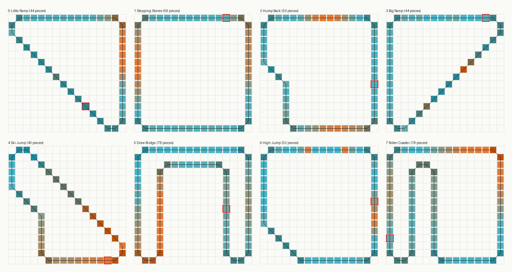
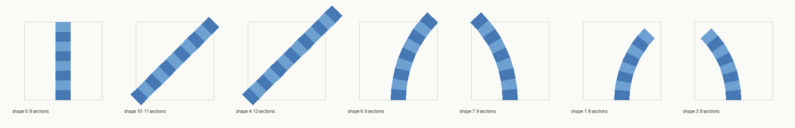

# The tracks' format

The 8 tracks are in `tracks/*.bin`. `BuildTrack` (`$5AE46`) reads one each time a track is shown or
raced (from `TrackPreview`), and turns it into the track's tables. This page describes those bytes
as `BuildTrack` reads them.

[`tools/tracks.py`](../tools/tracks.py) reads them the same way and prints each track.
`enhanced/tools/test_tracks.py` checks that reading against the game: in scremu it has the original
game build each of the 8 tracks, then compares every table `BuildTrack` writes with `tracks.py`'s.
All 8 tracks are the same, byte for byte. `tracks.py --map` draws the tracks on their grids:

Each square is a piece. Its colour is the piece's height, from blue (low) to orange (high), and
darker squares are bends and joins. The red outline marks the start and finish piece.

## The grid and the pieces

A track is a closed loop of pieces (40-78 of them) on a 16 x 16 grid, one piece per square. A
square is a byte: y x 16 + x (`TrackPieceGrid`; `BuildTrackGrid` fills `TrackGrid`, the piece in
each square). Each piece has:

* a **shape**, the piece's form in plan view (straight, diagonal, a half of a bend). Each shape has its
  own geometry in the 6502 data (`Data6502`, by shape): its cross-sections' points and how many
  sections it has;
* a **direction**: which way it runs on the grid;
* two **height profiles**, one for each side of the track. Side A is the cross-sections' even
  points and side B their odd points (`PiecePointHeight`). A profile is a height for each section's
  end. When the two profiles are the same the track is level across; when they differ it is banked.

The pieces join up: each side's heights carry on from the previous piece. A piece's base height
(`PieceHeightBaseA`, `PieceHeightBaseB`) is the height where the previous piece ended, less its
profile's first entry. From there the height so far is the base plus the profile's last entry.
The track starts at the height in its header.

## The bytes

| Bytes | What | Into |
|---|---|---|
| 1 | the number of pieces | `TrackPieceCount` |
| 1 | the piece the cars start on | `StartingPiece` (the opponent is put there: `Race`) |
| 1 | the piece before the one the laps count from | `LapCountPiece` (`LapStartPiece` = it + 1, or 0 past the last piece) |
| 1 | the start and finish piece | `StartPiece` (`CheckLapPiece`) |
| 2 | the height the track starts at: the low byte first | both sides' heights so far |
| ... | the pieces (below) | |
| 1, 1 | how many steps of a hard landing add to the damage, in the leagues and in the super league | `DamageSteps`, `DamageStepsSuper` (`SetRaceLimits`: into `HardLandingSteps`; see [Damage](#damage-from-hard-landings)) |
| 1, 1 | the boost at the start, in the leagues and in the super league | `BoostAtStart`, `BoostAtStartSuper` (`Race`: a count, made decimal) |
| 1 | n: the pieces whose speed for the opponent the track sets | `OpponentSpeedCount` |
| 1 | m: the pieces the car is not put back on | `NoRestartCount` |
| 2 n | n pairs: a piece and its speed (bit 7: exact) | `OpponentSpeedPieces`, `OpponentSpeedValues` |
| m | m pieces | `NoRestartPieces` (`PlaceCarOnPiece` skips them when the car is put back after leaving the track: probably the jumps' gaps) |

### A piece

| Bytes | What |
|---|---|
| 1 | its flags (below) |
| 1 | its grid square |
| 1 | its profile A |
| 1 | its profile B (left out when flags bit 5 is set: B is A) |

The flags byte:

| Bits | |
|---|---|
| 0-3 | the shape (0-14) |
| 4 | reversed: the shape is driven the other way (`PieceReversed`) |
| 5 | one profile byte: both sides the same |
| 6-7 | the direction on the grid: `$00` y + 1, `$40` x + 1, `$80` y - 1, `$C0` x - 1 |

**Repeats.** A flags byte whose low 4 bits are `$F` is not a piece. Its high 4 bits n say that
the next n pieces repeat the previous piece's flags. Those pieces have no flags or square bytes of
their own: each square is the previous one stepped in the flags' direction (`StepGrid`). A reversed
piece steps the other way, because bits 6-7 are flipped first. Their profile bytes still follow, one
or two each. For example, a straight run of 10 pieces takes a piece (4 bytes or 3), the repeat byte
`$9F` and 9 profile bytes.

**Profiles.** A profile byte's bits 0-6 index `HeightProfiles`, a table of 6502 pointers into the
6502 data. The entries of the profile it points to come in one of two forms, chosen by bit 7 of
profile **A** (it decides the form for both of the piece's profiles):

* bit 7 clear: a byte each, height = (b & `$0F`) x 256 + (b x 2 & `$E0`);
* bit 7 set: two bytes each, height = (b0 & `$7F`) x 256 + b1.

Bit 7 of profile B in the file is not used. `BuildTrack` replaces it with a running parity, which
`LoadPiece` passes on (`SideSwap`). It flips with each piece by the number of the piece's points,
probably so that the track's stripes carry on from piece to piece.

**Shapes 12-14** take their profiles not from the file but from the bytes at `l_5B2B8` + 12 on: 3,
4, 4, 3, then the first bytes of the next routine. This is a table the 6502 version kept there. No
track uses these shapes.

### The shapes

A shape's geometry is in the 6502 data (`Data6502`, a pointer for each shape: `LoadPiece`). It is
read by `LoadPiece`, `CarPiecePosition` and `ReadPiecePoints`. `tracks.py --shapes` prints and
draws it:

Every shape is drawn in its own frame: a square 2048 across, entered at the middle of its near side
(x 1024, z 0) and going +z. `ReadPiecePoints` turns it into the grid's frame by the piece's
direction: as it is, with x and z swapped, or mirrored (2048 - the coordinate). The track is 384
wide, with side A at x 832 and side B at 1216 on a straight. Its sections are 256 long on a
straight.

| Shape | Sections | Pieces | What | `ShapeTurns` |
|---:|---:|---:|---|---|
| 0 | 8 | 316 | straight across the square, (1024, 0) to (1024, 2048) | `$00` |
| 10 | 11 | 33 | diagonal, corner to corner: (0, 0) to (2048, 2048) | `$40` |
| 4 | 13 | 12 | diagonal, from a corner to 300 past the far one: (0, 0) to (2348, 2348) - a diagonal run's end | `$40` |
| 6 | 9 | 36 | a 45-degree bend to the right, radius 3072 (one and a half squares): (1024, 0) to (1924, 2172) | `$80` |
| 7 | 9 | 36 | the same to the left: to (124, 2172) | `$C0` |
| 1 | 8 | 8 | a 45-degree bend to the right, radius 2472, onto the square's diagonal: to (1748, 1748) | `$80` |
| 3 | 8 | 4 | the same to the left: to (300, 1748) | `$C0` |

A 90-degree corner is two bends, a 6 and a 7 (one of them reversed), on two squares diagonally
apart. A diagonal run starts and ends with a 1 or a 3, and the 4s make up the 300 the bend stops
short of the corner. Shapes 2, 5, 8, 9 and 11 are not used: their pointers in `Data6502` lead to code
and other data.

A shape's data:

| Bytes | What |
|---|---|
| 0 | n: where the point count is (4 straight, 8 diagonal, 12 bend) |
| 1 | the kind: `$00` straight, `$40` diagonal, `$80` / `$C0` a bend right / left (`PieceDirection`); bits 0-1 the shift for the bends' along |
| 2-3 | straight and diagonal: side A's place across (832, or -192 from the diagonal's line) |
| 4-5 | diagonal: its heading (`$2000`, 45 degrees) |
| 7 | diagonal: the along scale ((x + z) x it / 256: 181, 1/root 2) |
| 2-5 | bend: its centre (x, z: (4096, 0), (-2048, 0), (3496, 0), (-1449, 0)) |
| 6-7 | bend: the angle it starts at (x 64) |
| 8 | bend: the along scale (the angle's) |
| 9-10 | bend: side A's radius (its across is that less the car's distance from the centre) |
| n | the points: 2 at each section's end (18 to 28) |
| n + 1 | bit 0: across measured the other way (`AcrossOtherWay`) |
| n + 2 | `ShapeAcrossScale`: the scale (x 128) `TrackUnderWheels` puts the car's points' offsets across by |
| n + 3 | `ShapeAlongScale`: the same for the offsets along, and for the opponent's speed (`MoveOpponent`) |
| n + 6 | `ShapeSteer`: the steering's strength on the piece, and on a bend the car's own turn round it (`CarPhysicsPieces`) |
| n + 7 on | the points: (x, z), two words each, the low byte first; side A then side B at each end |

## What `BuildTrack` works out

* `PieceDistances`: each piece's distance from the first, at 32 for each section. `TrackLength` is
  the whole track's.
* `PieceHeightBaseA` and `PieceHeightBaseB`: the base heights (above).
* `PieceOpponentSpeeds`: each piece's speed for the opponent (below).

## The opponent's speed

The opponent drives at a target speed for its piece (`OpponentTargetSpeed`):
`PieceOpponentSpeeds`, capped by its top speed for the race (`OpponentTopSpeed`), or exactly the
piece's when its bit 7 is set. Above that speed it brakes (`OpponentBraking`), twice as hard when
14 or more above; below it, it speeds up, twice as hard unless it has only just stopped braking.
Its speed is `OpponentSpeed`, which knocks slow too (`ApplyCollision`).

`BuildTrack` works out the pieces' speeds from the last piece back to the first:

* a piece the track sets takes the track's speed. If its bit 7 is set (exact), the 3 pieces before it
  are made exact too, so the opponent arrives at a jump at the speed the jump needs;
* a bend (bit 7 of `ShapeTurns`: shapes 1, 3, 6, 7) takes the race's bend speed
  (`OpponentBendSpeed`); the speed carried back is 10 below it;
* any other piece takes the speed carried back plus 10, up to `$7F`. So the pieces before a bend
  step down to it 10 at a time: where it brakes.

`SetRaceLimits` picks the race's two speeds when the track is built (a run of `Random` first),
each as `Random` and a mask, plus a base, from `OpponentSpeedLimits` by the track:

| | Little Ramp | Stepping Stones | Hump Back | Big Ramp | Ski Jump | Draw Bridge | High Jump | Roller Coaster |
|---|---|---|---|---|---|---|---|---|
| top speed, leagues | 65-72 | 58-65 | 62-69 | 65-72 | 72-79 | 81-88 | 72-79 | 79-86 |
| bend speed, leagues | 72 | 65 | 69 | 72 | 79 | 88 | 79 | 86 |
| top speed, super league | 102-109 | 87-90 | 87-90 | 89-92 | 89-92 | 105-108 | 98-105 | 100-103 |
| bend speed, super league | 97-104 | 85-88 | 83-86 | 86-89 | 88-91 | 91-92 | 90-93 | 98-101 |

In the leagues the bend speed is at or above the top speed, so the opponent does not slow for
bends there, only for the speeds the track sets (its jumps). In the super league it is faster and
brakes for the bends.

## Damage from hard landings

The track's `DamageSteps` (`DamageStepsSuper` in the super league) becomes `HardLandingSteps`. For
each of the car's three wheel springs (`WheelsOnTrack`), when the spring is pressed harder than
`$700`, `HardLandingCount` counts the steps it stays so (not on the clock's ticks). While the count
is below `HardLandingSteps`, the excess (from `$600`, x 1.5 / 256) is added to the knock's strength
(`KnockStrength1`-3) and a knock is flagged. That is what cracks and damages the car (`CarKnocks`).
After that many steps a long hard press does no more damage. The count starts again when the spring
eases. Roller Coaster allows 3 steps, Draw Bridge 4, Big Ramp 10.

## The draw bridge

On Draw Bridge (track 5) `UpdateDrawBridge` runs at the race's start and every step. The bridge is
pieces 51-55 (squares 6-10 along the top). Its two leaves are pieces 51-52 and 54-55, which use
height profiles `$5F`-`$62` (2-byte entries). Piece 53 between them is flat, and 51-54 are in
`NoRestartPieces`. The bridge moves by rewriting those four profiles in the 6502 data:

* the phase (`BridgePhase`) counts on each step except the clock's ticks. v = |(phase & 31) - 16|
  (0-15), a triangle wave over 32 steps;
* each leaf is a straight slope rising from its outer end, (v + 4) x 32 a section for 16 sections:
  the tips 1,920 high at v = 0 and 9,120 at v = 15. The second leaf is the first mirrored. The
  joints between the profiles repeat an entry, and the entries at the tips are 0, so each leaf ends
  in a drop to the gap;
* while a car is on pieces 51-55, or the opponent is on its approach just after, the bridge is held
  where it is (`BridgeHeld`);
* the far view's model of piece 51 is moved with it (its points' heights from the profiles and
  `PieceHeightBaseA`);
* the opponent's speeds are set for the phase: the leaves' (pieces 51-52) from `BridgeLeafSpeeds`
  by v, exact; the approach's (pieces 48-50) from `$C6` + steps from `BridgeApproachSteps`, exact,
  when the opponent reaches piece 47 (or 12 steps ahead while the bridge is held). That way it
  jumps the gap.

`tracks.py`'s `bridge_profiles` works the profiles out for a phase. `test_tracks.py` races on the
Draw Bridge and compares them with the game's at 32 points (24 different phases): all the same.

## The 8 tracks

| Track | Pieces | Sections | The cars start on | Laps from | Start/finish | Starting height | Highest | Boost |
|---|---:|---:|---:|---:|---:|---|---|---|
| Little Ramp | 44 | 398 | 15 | 16 | 37 | `$0500` | `$1D40` | 34 (47) |
| Stepping Stones | 56 | 456 | 42 | 43 | 14 | `$0F00` | `$2DA0` | 48 (52) |
| Hump Back | 53 | 442 | 46 | 47 | 19 | `$0540` | `$1F80` | 41 (49) |
| Big Ramp | 44 | 398 | 1 | 2 | 24 | `$0780` | `$21A0` | 43 (41) |
| Ski Jump | 40 | 379 | 15 | 16 | 35 | `$6A40` | `$6CA0` | 43 (40) |
| Draw Bridge | 78 | 640 | 42 | 43 | 4 | `$11A0` | `$4BE0` | 72 (72) |
| High Jump | 52 | 438 | 29 | 30 | 4 | `$0640` | `$15C0` | 44 (42) |
| Roller Coaster | 78 | 640 | 0 | 1 | 37 | `$0500` | `$73A0` | 80 (89) |

The boost is the leagues' figure, with the super league's in brackets.

Still to work out: the shapes' bytes `n + 2`, `n + 3`, `n + 6` (the same in every shape but
`n + 6`: `$20` straight and diagonal, `$32` and `$3E` the bends - used by `CarPhysicsPieces`, not
studied), and the bit 7 `UpdateDrawBridge` sets on one entry of the bridge's profiles (the heights
mask it off).
